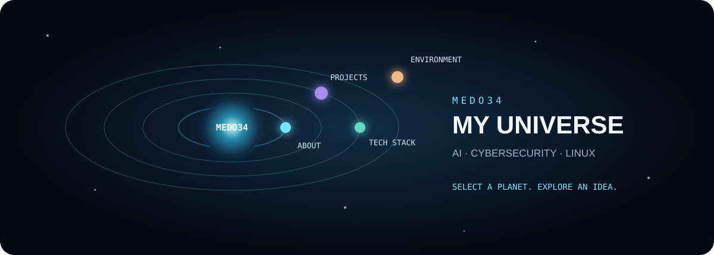

<div align="center">

# `MEDO34OP`

### AI DEVELOPER • CYBERSECURITY • LINUX


</div>

---

<div align="center">

## 🌌 MEDO34OP UNIVERSE

<a href="https://medo34op.github.io/medo34op/">
  
</a>

**[ ENTER THE UNIVERSE ↗](https://medo34op.github.io/medo34op/)**

*An interactive map of my projects, tools, and developer environment.*

</div>

---

## `$ whoami`

```python
class Developer:
    def __init__(self):
        self.name = "Medo34op"
        self.focus = ["Artificial Intelligence", "Cybersecurity"]
        self.environment = ["Arch Linux", "Apsis Rice"]
        self.goal = "Build things that once seemed impossible"

    def currently(self):
        return {
            "building": "Blurey",
            "learning": ["AI", "Cybersecurity", "Python"]
        }
```

**Environment:** Arch Linux · [Apsis Rice ↗](https://github.com/Aws-702/Apsis)

## `$ tech --stack`

<div align="center">
  
</div>

## `$ projects`

- **Blurey** — Exploring intelligent systems and AI.
- **Bluru** — An AI-powered bug discovery concept.

## `$ github --stats`

<div align="center">
  
</div>

---

<div align="center">

*“The ones who are crazy enough to think they can change the world, are the ones who do.”*

— **Steve Jobs**

</div>
